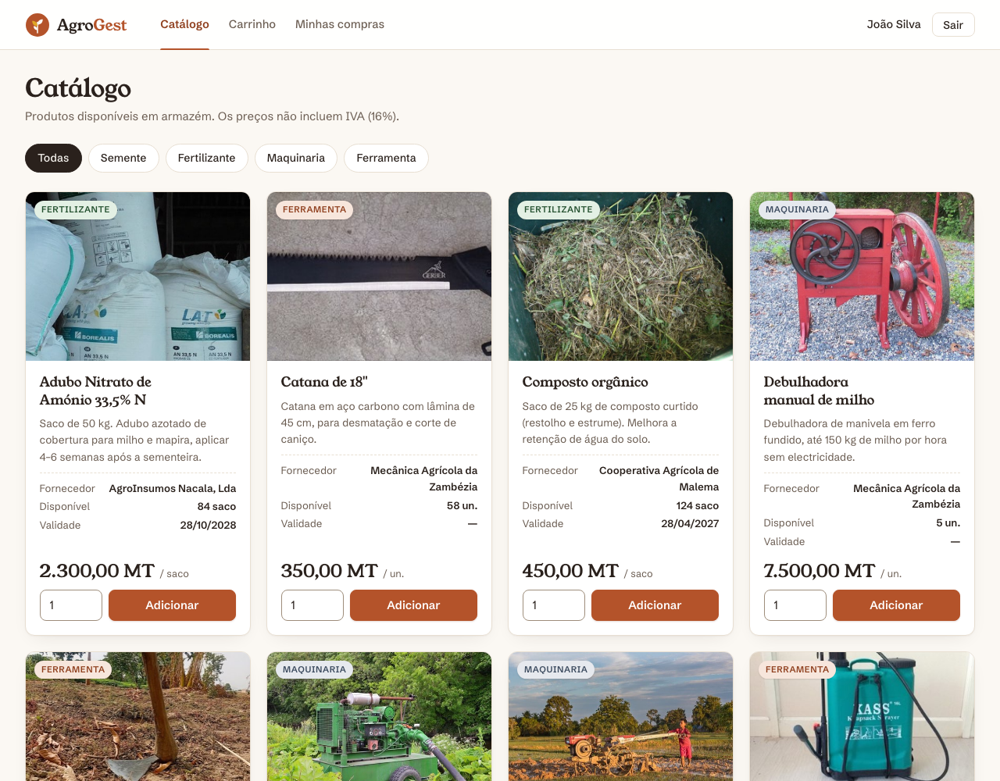

# AgroGest — Sistema de Gestão Agrícola

Aplicação web em **Java 17 + Jakarta Servlets 6 + JSP/JSTL**, publicada no **Apache Tomcat 10.1** e construída com **Maven** (sem Spring Boot).
Todos os dados vivem em **memória RAM** (listas Java) e são serializados para ficheiro; não há base de dados.

Trabalho prático de **Sistemas Distribuídos** — Engenharia Informática, ISCTEM, 2026.

**Autores:** Caiado Binda, Ranim Amade e Ziyad Luto

**[Manual de Uso (PDF)](Manual-de-Uso-AgroGest.pdf)** · **[WAR pronto a publicar](dist/agrogest.war)** · [Créditos das fotografias](docs/CREDITOS-IMAGENS.md)



---

## 1. Credenciais de teste

| Perfil | Email | Palavra-passe |
|---|---|---|
| Administrador (conta fixa, criada no arranque) | `admin@agro.mz` | `admin234` |
| Clientes de demonstração | `ana@teste.mz`, `carlos@teste.mz`, `fatima@teste.mz`, `joaquim@teste.mz`, `abdul@teste.mz`, `ernesto@teste.mz`, `maria@teste.mz`, `luisa@teste.mz` | `cliente123` |

Novos clientes registam-se em `/registo`.

### Dados de demonstração

No primeiro arranque (sem ficheiro de dados) o sistema carrega um cenário realista do início da campanha agrícola em Nampula:

| Entidade | Conteúdo |
|---|---|
| Fornecedores (4) | Sementes do Norte (Nampula), Cooperativa Agrícola de Malema, AgroInsumos Nacala, Mecânica Agrícola da Zambézia |
| Produtos (15, com fotografia) | Sementes de variedades libertadas pelo IIAM e cultivadas no norte: milho **Matuba**, feijão nhemba **IT-18**, amendoim **Nametil**, mapira **Macia**, e ainda gergelim **Lindi**. Adubos: nitrato de amónio 33,5%, ureia 46%, composto. Ferramentas: enxada, catana, regador, pulverizador de dorso. Máquinas: motocultivador, debulhadora manual de milho, motobomba |
| Clientes (8) | Pequenos e médios produtores de Nampula, Ribáuè, Nacala-Porto, Malema, Murrupula, Monapo e Mecubúri; 2 ainda sem compras |
| Vendas (10) | Facturas FT-2026-1 a FT-2026-10 das últimas 7 semanas, com IVA de 16% |
| Campanhas (2, fechadas) | 2024/2025 e 2025/2026, com 4 cultivos (milho, feijão nhemba, gergelim) e 4 colheitas |

Os preços em meticais seguem os valores de mercado dos insumos. Os nomes de fornecedores e clientes, os contactos e os endereços são **fictícios**.
As fotografias são do Wikimedia Commons, com licenças livres (CC BY-SA / CC0). Autores e licenças estão em [docs/CREDITOS-IMAGENS.md](docs/CREDITOS-IMAGENS.md).

---

## 2. Requisitos

| Ferramenta | Versão |
|---|---|
| JDK | 17 ou superior |
| Apache Maven | 3.8 ou superior |
| Apache Tomcat | 10.1.x (Jakarta EE 10) |

---

## 3. Compilar

```bash
mvn clean package
```

Gera `target/agrogest.war` e corre os testes JUnit (`VendaServiceTest`: IVA, venda atómica, 50 compras concorrentes, isolamento de facturas e email único).
Já existe uma cópia pronta a publicar em **`dist/agrogest.war`**.

---

## 4. Deploy

### 4.1 Local (Windows, macOS ou Linux)

1. Descarregar e extrair o Tomcat 10.1: <https://tomcat.apache.org/download-10.cgi>
2. Mudar a porta para **8081** em `conf/server.xml`:
   ```xml
   <Connector port="8081" protocol="HTTP/1.1" connectionTimeout="20000" redirectPort="8443" />
   ```
3. Copiar `dist/agrogest.war` para `webapps/`.
4. Arrancar: `bin/startup.sh` (Linux/macOS) ou `bin\startup.bat` (Windows).
5. Abrir **<http://localhost:8081/agrogest/>**.
6. Parar com `bin/shutdown.sh`. O estado é gravado automaticamente nesse momento.

### 4.2 Servidor Linux com systemd

O script `deploy/instalar.sh` instala o Java 17 (se faltar), o Tomcat 10.1 em `/opt/tomcat` na porta 8081, cria o utilizador `tomcat`, regista o serviço systemd e publica o WAR:

```bash
mvn clean package && cp target/agrogest.war dist/
sudo ./deploy/instalar.sh dist/agrogest.war
```

Operação do serviço (unidade em `deploy/tomcat.service`):

```bash
sudo systemctl start tomcat      # arrancar
sudo systemctl stop tomcat       # parar (grava o estado em /var/lib/agrogest/agrogest.ser)
sudo systemctl restart tomcat    # reiniciar (o estado é restaurado no arranque)
sudo systemctl status tomcat     # estado
sudo systemctl enable tomcat     # arrancar com o sistema
journalctl -u tomcat -f          # logs do serviço
tail -f /opt/tomcat/logs/catalina.out
```

Para publicar uma nova versão basta voltar a correr `instalar.sh` com o novo WAR.

### 4.3 Onde ficam os dados

Ficheiro `agrogest.ser` (mais `agrogest.ser.bak`), na primeira pasta definida entre:

1. propriedade de sistema `-Dagrogest.dados=/caminho` (no serviço systemd: `/var/lib/agrogest`);
2. `context-param` `agrogest.dados` em `WEB-INF/web.xml`;
3. `$CATALINA_BASE/agrogest-dados`.

Para voltar aos dados de demonstração: **Persistência → Eliminar ficheiro** e reiniciar o Tomcat, ou apagar a pasta com o Tomcat parado.

---

## 5. Arquitetura

```
 Browser ──HTTP :8081──► Apache Tomcat 10.1
                         │
                         ├─ filter/   AuthFilter ........ sessão + perfil (403 / redirect para login)
                         ├─ servlet/  Controladores ..... Login, Registo, Catálogo, Carrinho, Compra,
                         │                                Factura, MinhasCompras, admin/* (CRUDs,
                         │                                Listagens, Relatórios, Persistência)
                         ├─ service/  Regras de negócio . VendaService (synchronized, transacional),
                         │                                CatalogoService, AgricolaService,
                         │                                AuthService, RelatorioService
                         ├─ repo/     DataStore ......... listas em memória + AtomicInteger
                         │            Persistencia ...... serialização atómica (.ser)
                         ├─ model/    POJOs Serializable
                         ├─ listener/ AppListener ....... restaura no arranque / grava no encerramento
                         ├─ util/     PasswordUtil, Params, Flash, Formatos, Ordenacao, DadosIniciais
                         └─ WEB-INF/views/  JSP + JSTL + EL + CSS (vistas inacessíveis por URL direto)
```

**Fluxo MVC.** O pedido passa pelo `AuthFilter`, chega a um Servlet, que lê e valida os parâmetros (`Params`) e chama um Service. O Service aplica as regras de negócio sobre o `DataStore`. O Servlet coloca o resultado em atributos do pedido e faz *forward* para a JSP em `/WEB-INF/views`. As escritas seguem o padrão **Post/Redirect/Get**, com mensagens "flash" na sessão, o que evita reenvios ao fazer F5.

### 5.1 Pacotes

| Pacote | Conteúdo |
|---|---|
| `mz.agrogest.model` | `Utilizador`, `Fornecedor`, `Produto`, `Campanha`, `Cultivo`, `Colheita`, `Venda`, `VendaItem`, `Carrinho`, `ItemCarrinho`, `ResumoCliente`, enums `Perfil`, `Categoria`, `TipoFornecedor` |
| `mz.agrogest.repo` | `DataStore` (singleton, `Collections.synchronizedList` + `AtomicInteger`), `Snapshot`, `Persistencia` |
| `mz.agrogest.service` | `AuthService`, `CatalogoService`, `AgricolaService`, `VendaService`, `RelatorioService`, `NegocioException`, `AcessoNegadoException` |
| `mz.agrogest.servlet` | `BaseServlet` e servlets do cliente; `servlet.admin` com os do administrador |
| `mz.agrogest.filter` | `AuthFilter` (`@WebFilter("/*")`, sessão e perfil), `CacheFilter` (cabeçalhos de cache dos ficheiros estáticos) |
| `mz.agrogest.listener` | `AppListener` (`@WebListener`) |
| `mz.agrogest.util` | Hash de passwords, validação de parâmetros, formatação (funções EL `ag:`), ordenação, dados iniciais |

### 5.2 Rotas

| Rota | Acesso | Função |
|---|---|---|
| `/login`, `/registo`, `/logout` | público | autenticação e auto-registo |
| `/catalogo?categoria=` | sessão | catálogo com filtro por categoria |
| `/carrinho`, `/carrinho/{adicionar,atualizar,remover,esvaziar}` | cliente | carrinho em sessão |
| `/compra` | cliente | GET confirmação · POST emite a factura |
| `/factura?id=` | sessão | o cliente vê só as suas, o admin vê todas |
| `/minhas-compras` | sessão | histórico do cliente |
| `/admin/dashboard` | admin | indicadores, últimas vendas, stock baixo |
| `/admin/{fornecedores,produtos,campanhas,cultivos,colheitas}` | admin | gestão (CRUD) |
| `/admin/listagens?tipo=produtos\|fornecedores\|clientes\|armazem\|compras&ordem=&dir=` | admin | listagens ordenáveis |
| `/admin/relatorios` | admin | relatórios de clientes |
| `/admin/persistencia` | admin | gravar, restaurar e eliminar o ficheiro |

### 5.3 Regras de negócio

| Regra | Implementação |
|---|---|
| a) Não vender acima do stock | Verificado ao adicionar ou atualizar o carrinho, no ecrã de confirmação e de novo dentro da transação (`VendaService.verificarDisponibilidade`) |
| b) Venda atómica (tudo ou nada) | `VendaService.finalizarCompra`: dentro de `synchronized (store)` valida **todos** os itens primeiro e só depois desconta. Se um item falhar, nada é alterado. Testado com 50 threads concorrentes |
| c) Cliente só vê as suas facturas | `VendaService.obterFactura` lança `AcessoNegadoException`, que resulta em HTTP 403 |
| d) `/admin/*` só para admin | `AuthFilter`: cliente autenticado recebe **403**; sem sessão é redirecionado para o login |
| e) Rotas de compra exigem sessão | `AuthFilter` (`/catalogo`, `/carrinho/*`, `/compra`, `/factura`, `/minhas-compras`) |
| f) IDs sequenciais | `AtomicInteger` por entidade no `DataStore`. A factura usa `FT-<ano>-<id da venda>` |
| Extra | Não remover campanha com cultivos, cultivo com colheitas ou fornecedor com produtos. Não registar cultivos em campanha fechada. Colheita não pode ser anterior ao plantio. Datas de fim ≥ início. Produtos expirados não aparecem no catálogo |

### 5.4 Concorrência

* Listas `Collections.synchronizedList`. As leituras devolvem cópias feitas sob o lock da lista.
* Operações compostas (ler, validar, escrever), como venda, reposição de stock, registo com email único e remoções com dependências, são feitas em `synchronized (DataStore.get())`.
* O `Snapshot` para gravação é obtido sob o mesmo lock, por isso nunca grava uma venda a meio.

### 5.5 Persistência tolerante a falhas

`Persistencia.gravar` serializa um `Snapshot` (`ObjectOutputStream`) para `agrogest.ser.tmp` e força a escrita em disco (`fsync`). Depois copia o ficheiro atual para `.bak` e só no fim renomeia `.tmp` para `agrogest.ser` com `ATOMIC_MOVE`.
Se o processo morrer a meio, o ficheiro anterior continua intacto. Se o principal estiver corrompido, o arranque usa o `.bak`.
Gravação automática no `contextDestroyed`, restauro no `contextInitialized` e endpoint manual em `/admin/persistencia`.

### 5.6 Segurança

* Passwords guardadas com **PBKDF2-HMAC-SHA256** (65 536 iterações, salt aleatório de 16 bytes). Nenhuma password em texto puro.
* `changeSessionId()` no login e no registo (previne *session fixation*). Cookie de sessão `HttpOnly`.
* Saída de texto do utilizador escapada com `<c:out>` (previne XSS). JSPs em `/WEB-INF` não são acessíveis diretamente.
* O redirecionamento pós-login só aceita caminhos da própria aplicação.

### 5.7 Interface

Só **JSP + JSTL + EL + HTML5 + CSS3** próprio (`css/style.css`), em português e responsiva, com menu "hambúrguer" feito apenas com CSS.
A única linha de JavaScript é `onclick="window.print()"` no botão **Imprimir factura**. O `Ctrl+P` também funciona, e uma folha `@media print` esconde o menu e os botões.

---

## 6. Estrutura do projeto

```
agrogest/
├── pom.xml
├── README.md
├── Manual-de-Uso-AgroGest.pdf         manual de utilização (admin e cliente)
├── dist/agrogest.war                  WAR pronto a publicar
├── deploy/
│   ├── tomcat.service                 unidade systemd
│   └── instalar.sh                    instalação + deploy em Linux
├── docs/
│   ├── manual.html                    fonte do manual (gera o PDF)
│   ├── CREDITOS-IMAGENS.md            autores e licenças das fotografias
│   └── img/                           capturas de ecrã
└── src/
    ├── main/java/mz/agrogest/{model,repo,service,servlet,filter,listener,util}
    ├── main/webapp/
    │   ├── css/style.css   fonts/ (Young Serif, Schibsted Grotesk)
    │   ├── img/            logo.svg, sem-foto.svg, produtos/*.jpg
    │   └── WEB-INF/
    │       ├── web.xml   agrogest.tld (funções EL)
    │       ├── tags/     ordem.tag, vazio.tag
    │       └── views/    *.jsp, admin/*.jsp, _cabecalho.jspf, _rodape.jspf
    └── test/java/mz/agrogest/service/VendaServiceTest.java
```
